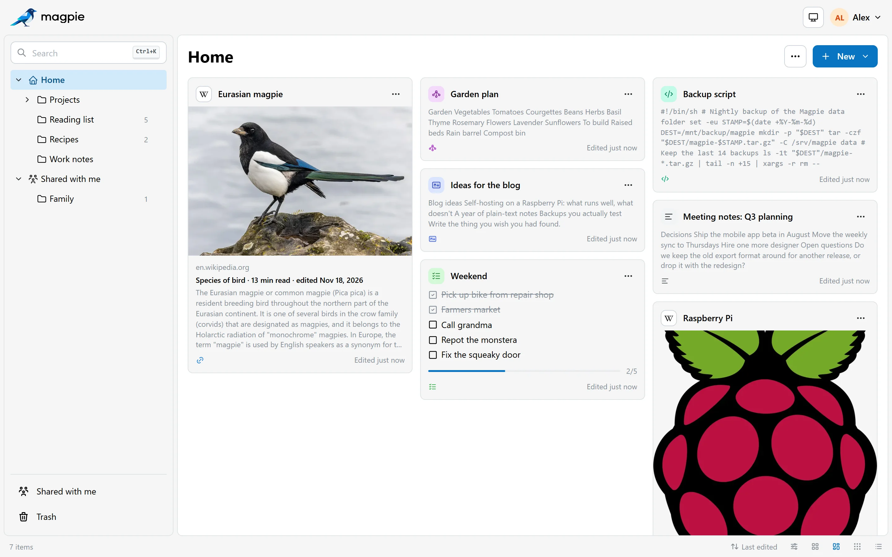
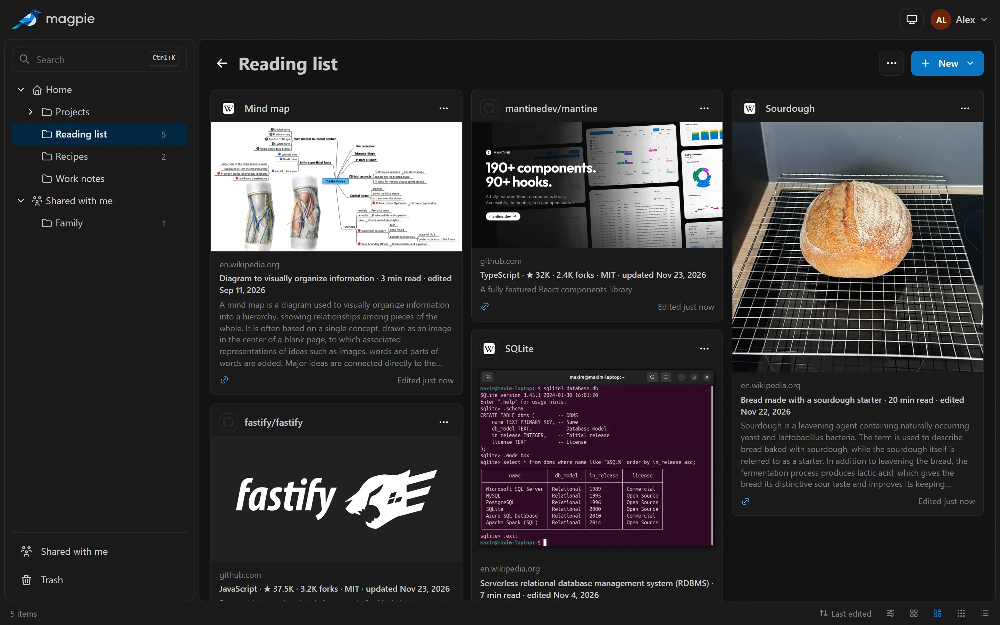
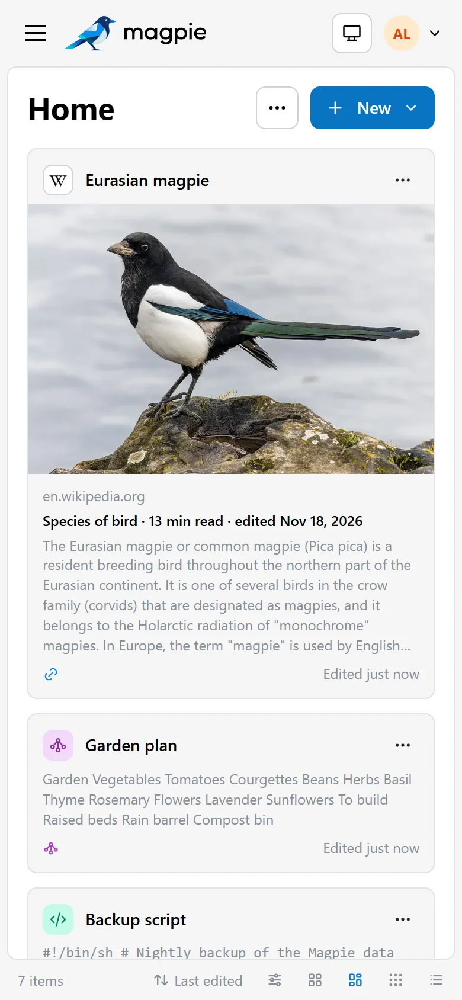
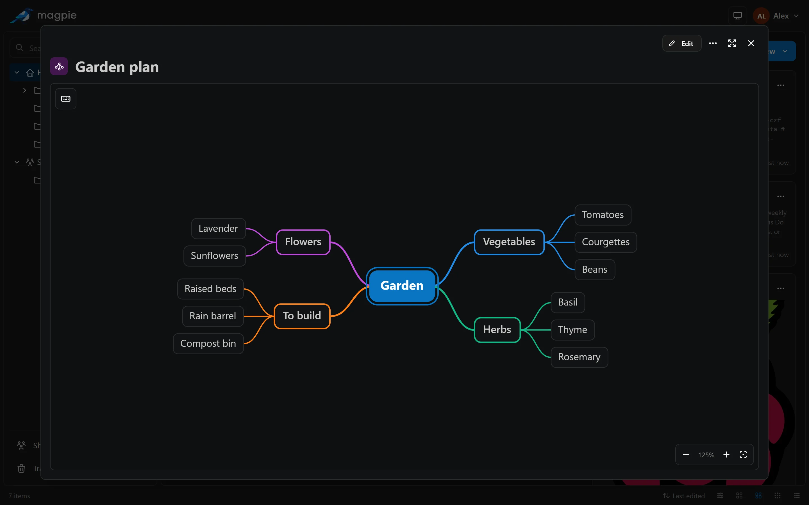

<h1>
  <picture>
    <source media="(prefers-color-scheme: dark)" srcset="docs/images/magpie-logo-dark.svg">
    
  </picture>
</h1>

**A lightweight, self-hosted notes and bookmarks app for you and the people you share with.** Like its namesake, it collects whatever catches your eye.

Text, Markdown, code, checklists, mind maps and links with rich previews, all in one folder tree. Magpie runs as a single Docker container, keeps everything in one encrypted SQLite file, and needs nothing else.



> [!NOTE]
> **Magpie is built with AI.** Almost all of its code, tests and documentation were written by an AI coding assistant ([Claude Code](https://claude.com/claude-code)), directed by a human maintainer. Nothing here has been reviewed or audited by an independent professional, including the encryption and sign-in. If that matters to you, read [how Magpie is made](docs/how-it-is-made.md) before you use it.

## Features

- 📝 **Six note types side by side**: rich text, Markdown, code (100+ languages), checklists, mind maps and links
- 🔗 **Link previews** with title, image and details for shops, recipes, movies, books, videos, music, GitHub, Wikipedia and more. Images are stored on your server, so your browser never contacts the linked site
- 🗂️ **Folders your way**: nest them, drag notes around, and choose grid, masonry, compact or list view per folder, sorted by date, title or your own drag-and-drop order
- 🤝 **Sharing** of folders or single notes with other users, as view-only or editable
- 🔒 **Private folders** that stay hidden everywhere until you unlock them with a PIN
- 🔐 **Encrypted at rest**: database and files are unreadable without your key
- ⚡ **Live updates** across devices and people, with autosave and conflict handling
- 🔍 **Full-text search**, trash with restore, import (browser bookmarks, Markdown, OPML, …) and export
- 🔑 **Sign in** with a password, GitHub or any OpenID Connect provider
- 📱 **Installable app** (PWA) for desktop and phone, with light and dark themes

## Screenshots

<table>
  <tr>
    <td width="63%">
      
      <br><sub>Link previews with images and details, in dark mode</sub>
    </td>
    <td width="37%" rowspan="2" valign="top">
      
      <br><sub>On a phone</sub>
    </td>
  </tr>
  <tr>
    <td>
      
      <br><sub>Mind map</sub>
    </td>
  </tr>
</table>

## Quick start

You need Docker with Compose. Use the prebuilt image, or build it yourself from the source.

### Prebuilt image

Ready-made images for `linux/amd64` and `linux/arm64` (e.g. Raspberry Pi 4/5) are on the GitHub Container Registry as `ghcr.io/j-loewen/magpie`. The `latest` tag is always the newest release.

```sh
mkdir magpie && cd magpie
curl -fsSL -o .env https://raw.githubusercontent.com/j-loewen/magpie/main/.env.example
openssl rand -hex 32          # put the result into .env as ENCRYPTION_KEY
```

Create `docker-compose.yml` next to it:

```yaml
services:
  magpie:
    image: ghcr.io/j-loewen/magpie:latest
    container_name: magpie
    restart: unless-stopped
    ports:
      - "${MAGPIE_PORT:-8085}:3000"
    volumes:
      - /etc/localtime:/etc/localtime:ro
      - ./data:/data
    env_file:
      - .env
```

```sh
docker compose up -d
```

To update later: `docker compose pull && docker compose up -d`.

### From source

```sh
git clone https://github.com/j-loewen/magpie.git magpie && cd magpie
cp .env.example .env
openssl rand -hex 32          # put the result into .env as ENCRYPTION_KEY
docker compose up -d --build
```

### Then

Open http://localhost:8085 and register. **The first account becomes the admin.**

> Keep a copy of `ENCRYPTION_KEY` somewhere safe, away from the server. Without it your notes cannot be read.

Full instructions: [Installation](docs/installation.md).

## Documentation

| | |
|---|---|
| [Installation](docs/installation.md) | Setup, updates, running without Docker |
| [Configuration](docs/configuration.md) | All environment variables |
| [Encryption](docs/encryption.md) | What is protected and how to look after the key |
| [Backing up](docs/backups.md) | Backup and restore |
| [Sign-in providers](docs/sign-in.md) | GitHub and OpenID Connect |
| [Reverse proxy](docs/reverse-proxy.md) | HTTPS, Caddy, nginx, live updates |
| [Administration](docs/administration.md) | Roles, users, storage |
| [User guide](docs/user-guide.md) | Everything the app can do |
| [Keyboard shortcuts](docs/keyboard-shortcuts.md) | For notes, checklists and mind maps |
| [Development](docs/development.md) | Local setup, project layout, adding note types |
| [How Magpie is made](docs/how-it-is-made.md) | Built with AI: what that means for you |

## Built with

TypeScript · React · [Mantine](https://mantine.dev) · [Fastify](https://fastify.dev) · SQLite with [Drizzle](https://orm.drizzle.team) · Docker · written with [Claude Code](https://claude.com/claude-code)

```sh
npm install && npm run dev    # API on :3000, web app on :5173
```

See [Development](docs/development.md).
